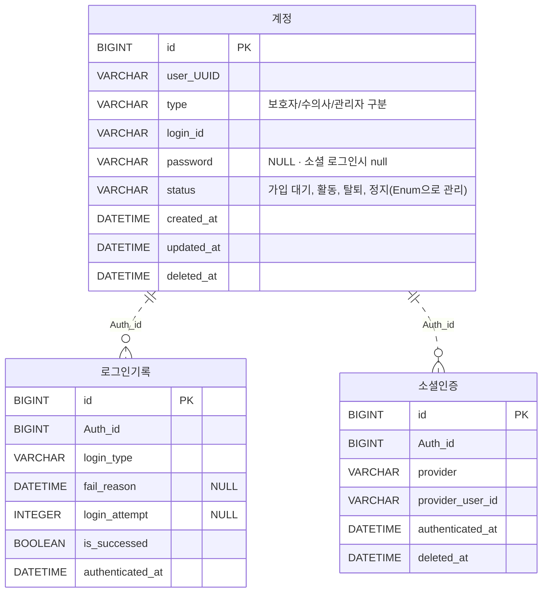
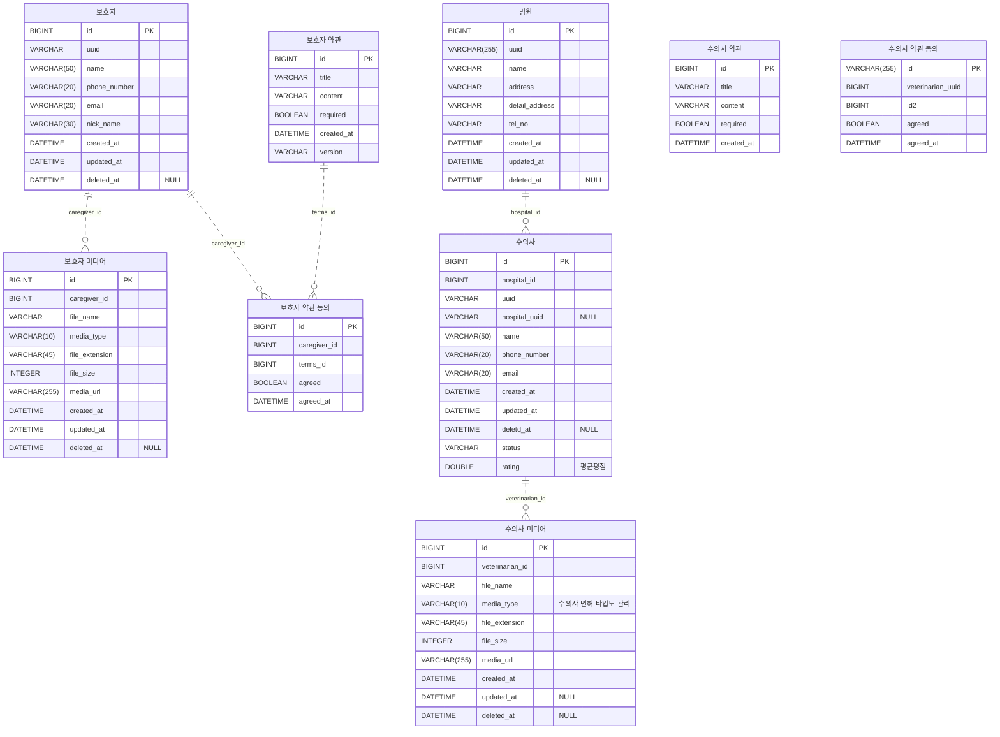
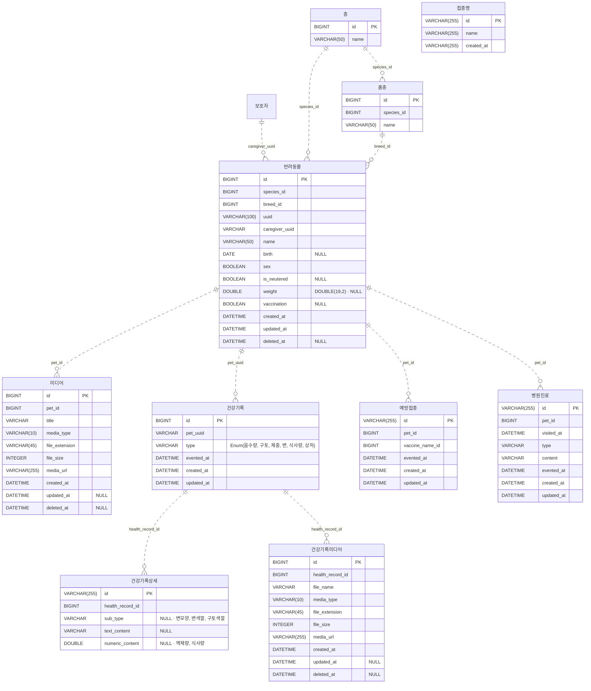
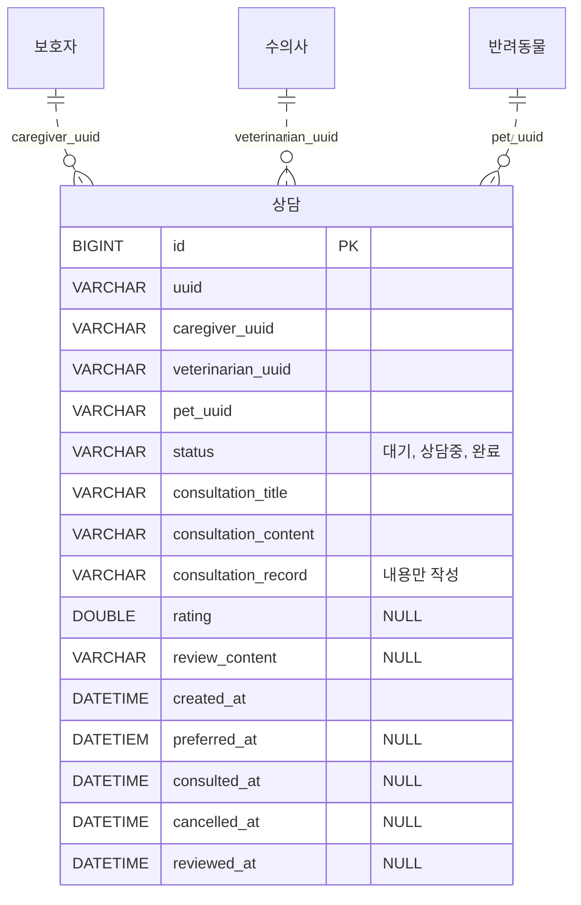
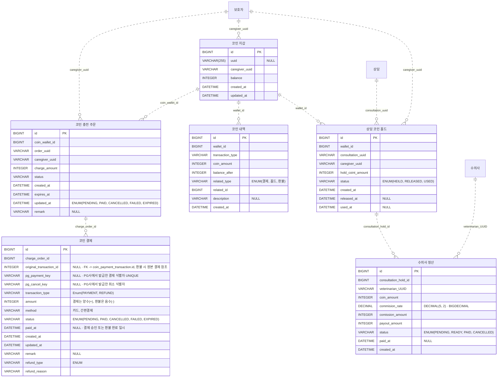
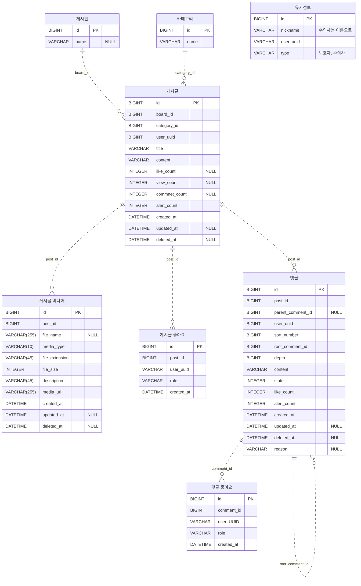
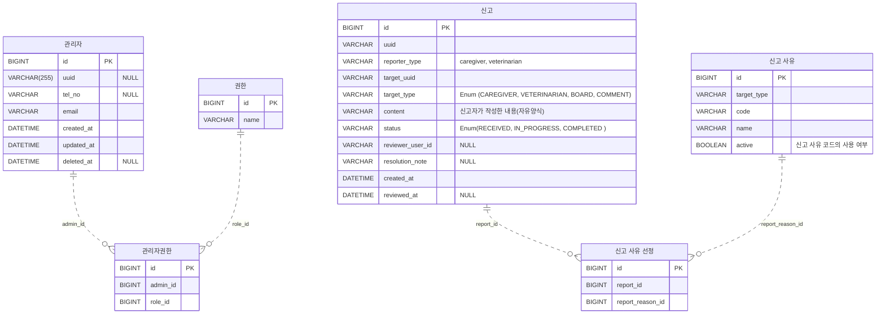

# ERD (Entity Relationship Diagram)

루이쿠리의 현재 ERD 초안을 도메인별로 정리했다. 테이블명, 컬럼명, 타입, NULL 허용 여부와 주석은 첨부 SQL을 기준으로 한다. 제품 요구사항은 [PRD](prd.md)에서 확인할 수 있다.

- `PK`는 첨부 SQL에 선언된 기본키이며, `NULL` 표기가 없는 컬럼은 `NOT NULL`이다.
- 점선은 컬럼명에서 추정한 참조 관계다. 관계의 개수는 참조 컬럼의 NULL 허용 여부를 바탕으로 표시했다. 첨부 SQL에는 FK와 UNIQUE 제약 선언이 없다.
- 다른 도메인의 참조 대상은 해당 다이어그램에 이름만 표시한다.

## 엔티티 목록

| 도메인 | 테이블 |
| --- | --- |
| 계정 · 인증 | `계정` |
| 계정 · 인증 | `로그인기록` |
| 계정 · 인증 | `소셜인증` |
| 보호자 · 수의사 · 병원 | `보호자` |
| 보호자 · 수의사 · 병원 | `보호자 미디어` |
| 보호자 · 수의사 · 병원 | `보호자 약관` |
| 보호자 · 수의사 · 병원 | `보호자 약관 동의` |
| 보호자 · 수의사 · 병원 | `수의사` |
| 보호자 · 수의사 · 병원 | `수의사 미디어` |
| 보호자 · 수의사 · 병원 | `수의사 약관` |
| 보호자 · 수의사 · 병원 | `수의사 약관 동의` |
| 보호자 · 수의사 · 병원 | `병원` |
| 반려동물 · 건강 기록 | `반려동물` |
| 반려동물 · 건강 기록 | `종` |
| 반려동물 · 건강 기록 | `품종` |
| 반려동물 · 건강 기록 | `미디어` |
| 반려동물 · 건강 기록 | `건강기록` |
| 반려동물 · 건강 기록 | `건강기록상세` |
| 반려동물 · 건강 기록 | `건강기록미디어` |
| 반려동물 · 건강 기록 | `예방접종` |
| 반려동물 · 건강 기록 | `접종명` |
| 반려동물 · 건강 기록 | `병원진료` |
| 상담 · 일지 · 후기 | `상담` |
| 코인 · 결제 · 정산 | `코인 지갑` |
| 코인 · 결제 · 정산 | `코인 충전 주문` |
| 코인 · 결제 · 정산 | `코인 결제` |
| 코인 · 결제 · 정산 | `코인 내역` |
| 코인 · 결제 · 정산 | `상담 코인 홀드` |
| 코인 · 결제 · 정산 | `수의사 정산` |
| 커뮤니티 | `유저정보` |
| 커뮤니티 | `게시판` |
| 커뮤니티 | `카테고리` |
| 커뮤니티 | `게시글` |
| 커뮤니티 | `게시글 미디어` |
| 커뮤니티 | `게시글 좋아요` |
| 커뮤니티 | `댓글` |
| 커뮤니티 | `댓글 좋아요` |
| 관리자 · 신고 | `관리자` |
| 관리자 · 신고 | `권한` |
| 관리자 · 신고 | `관리자권한` |
| 관리자 · 신고 | `신고` |
| 관리자 · 신고 | `신고 사유` |
| 관리자 · 신고 | `신고 사유 선정` |

## 1. 계정 · 인증

`계정.user_UUID`의 참조 대상은 `type`에 따라 보호자·수의사·관리자로 달라지는 것으로 보인다. 역할별 UUID 연결 방식과 유일성은 확인이 필요하다.

## 2. 보호자 · 수의사 · 병원

`수의사`에는 `hospital_id`와 `hospital_uuid`가 함께 있다. `수의사 약관 동의.veterinarian_uuid`는 `BIGINT`이고 `수의사.uuid`는 `VARCHAR`다. `veterinarian_uuid`와 `id2`의 참조 대상 컬럼을 확인해야 한다.

## 3. 반려동물 · 건강 기록

`예방접종.vaccine_name_id`의 참조 후보는 `접종명.id`다. 두 타입이 각각 `BIGINT`와 `VARCHAR(255)`이므로 연결 전에 참조 키와 타입을 확인해야 한다.

## 4. 상담 · 일지 · 후기

첨부본은 상담 일지와 후기 정보를 `상담.consultation_record`, `rating`, `review_content`, `reviewed_at`에 담는다. `preferred_at`의 타입은 원본에 `DATETIEM`으로 적혀 있다.

## 5. 코인 · 결제 · 정산

`코인 결제.original_transaction_id`의 원본 주석은 결제 자기 참조를 가리킨다. 이 컬럼은 `INTEGER`이고 `코인 결제.id`는 `BIGINT`다. `pg_payment_key`의 유일성은 주석에 기재돼 있다. `코인 내역.related_type`과 `related_id`의 대상 테이블은 유형별로 확인해야 한다.

## 6. 커뮤니티

게시글과 댓글의 `user_uuid`는 `BIGINT`이고 `유저정보.user_uuid`와 좋아요 테이블의 사용자 UUID는 `VARCHAR`다. 작성자와 좋아요 사용자에 각각 어떤 식별자를 저장할지 확인해야 한다.

## 7. 관리자 · 신고

`신고.target_uuid`는 `target_type`에 따라 참조 대상이 달라진다. 게시글과 댓글에는 첨부본 기준 `BIGINT id`가 있어 신고 대상 식별 방식과 `reviewer_user_id`의 참조 대상을 확인해야 한다.

## 참고

문서 구성은 [FinPlay 백엔드 ERD](https://github.com/finplay-team/finplay-backend/blob/dev/docs/erd.md)의 엔티티 목록과 도메인별 다이어그램 형식을 따랐다.
